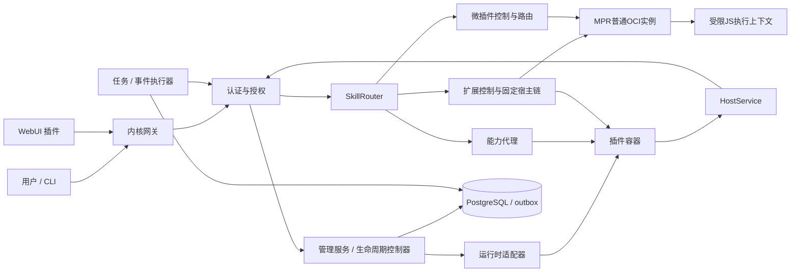

# 模块、调用边界与信任关系

[文档总目录](../README.md)

> 规格版本：2.8.0；状态：待实现的规范性设计。MUST/必须表示实现及验收要求，不能理解为现有功能。

## 本机组成

## 内核模块职责

| 模块 | 独占的写入/决策职责 | 禁止承担 |
|---|---|---|
| Identity | 账户、会话、凭证与来源链校验 | 相信插件提供的身份请求头 |
| Authorizer | 动作、对象、条件、祖先上限的最终判断 | 只信 WebUI 已隐藏按钮 |
| Lifecycle | 期望部署的控制循环与管理操作进度 | 业务执行逻辑 |
| Admission | 节点预算预留、释放与本机限额 | 把内核预留借给插件 |
| Runtime | OCI、卷挂载、网络及实际观测 | 向插件暴露运行时 socket |
| Registry | 已验证能力实例的可路由快照 | 自行启动实例 |
| SkillRouter | 固定安装或微版本/制品/部署、授权、输入校验及业务转发 | 任意URL、即时源码或按名字选择最新微版本 |
| MicroPlugin控制器 | 微对象/版本/部署、候选Skill、MPR绑定及Prepare/Release对账 | 将微制品伪装成普通OCI安装、在内核执行JS |
| Extension控制器 | 扩展对象/版本/固定宿主链、候选Skill、DAG及根协议对账 | 注入任意代码、隐式反向宿主启动依赖或借宿主授权执行 |
| Broker | 校验契约、路由、委托、取消及流控 | 对未知副作用自动重放 |
| TaskEngine | DAG、租约、尝试、fence、恢复 | 声称任务记录可证明外部操作未发生 |
| EventStore | 持久投递、租约与确认游标 | 默认恰好一次 |

## 信任来源

外部请求身份由会话或密钥验证获得；插件工作负载身份从当前代次的 mTLS 或受保护 UDS peer 获得。所有正文中的账户 ID、部署 ID 都仅为待校验目标。

控制数据库、内核签名密钥、运行时接口位于内核/宿主信任边界。第三方插件、其前端脚本及业务输出不可信。必要 PostgreSQL/运行时由宿主服务管理，不是可任意禁用的普通插件。

微制品也不可信。内核验证所有者、不可变摘要和Schema，MPR验证收到的版本/制品及受限引擎条件；两个入口均不接受正文覆盖已验证主体。JS执行上下文只接收业务JSON，没有MPR实例证书、父调用句柄或HostService客户端。

[预设插件](../preset-plugins/README.md)与[Skill层](../skills/overview.md)独立维护，知识库通过HostService调用可选embedding Skill，不直接连接模型容器。

## 异步批次与桌面

BatchEngine复用授权/Broker及租约fence算法，单独调度持久化Skill项目，不要求每次批处理先创建DAG。UI发现/本人偏好是核心轻量元数据接口；桌面、主题渲染、窗口/组件生命周期和消息桥在独立WebUI插件，页面在不可信隔离iframe中。详见[批次](../tasks/batches.md)和[WebUI](../preset-plugins/webui/README.md)。

## 微插件调用边界

普通Runtime适配器只启动MPR的OCI实例。微控制器把MicroDeployment绑定到精确runtime_deployment_id及runtime_installation_id，调用MicroRuntimeService.Prepare生成实例代次内句柄；SkillRouter通过同一服务Invoke执行，停用/归档由Release及取消收敛。

Prepare/Invoke/Release只接收内核mTLS请求，不发布用户直连路由；Cancel/QueryResult复用CapabilityService，MPR健康与启停复用普通PluginLifecycle。准备句柄是可重建的运行状态，不是授权票据。父实例重启后原句柄失效，微控制器重新Prepare固定版本，不改绑其他运行时。

准入顺序为MPR父实例槽/内存，再是微部署槽/执行预算；所有活动微执行及MPR自身开销共同受父部署限制。微插件不创建新OCI容器，不重复预留节点插件池，也不借内核4C16G。详见[微插件架构](micro-plugins.md)。

## 扩展控制与执行边界

[Extension控制器](extension-plugins.md)管理扩展身份、版本、固定宿主链与候选Skill，并将ordinary/micro/extension宿主统一解析到精确物理根。Prepare/Invoke/Release经ExtensionHostService仅发给该根OCI；中间扩展和微部署不是另一个RPC地址，也不能自报“已获得宿主权限”。

mode=data只传严格JSON贡献；mode=skill固定handler_skill_id与definition_digest，由核心按当前主体重新走SkillRouter授权、Schema、deadline及副作用检查。宿主代码不自行解析任意Skill名或借宿主服务账户执行。扩展处理器目标也进入完整DAG，不能绕回本扩展或祖先宿主形成递归。

扩展控制和宿主基础启动解耦：先使宿主基础Ready，再按拓扑Prepare扩展；不以“等待其扩展加载”作为宿主基础Ready的强前置。
