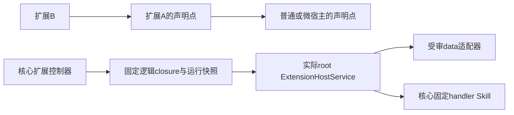

# 扩展插件、递归宿主与核心边界

[架构目录](README.md) · [扩展插件目录](../extensions/README.md) · [微插件架构](micro-plugins.md)

> 规格版本：2.8.0；状态：待实现的规范。扩展对象、宿主协议及转发链均需独立实现和验收。

## 第三种插件类型

Extension Plugin是依附宿主的独立核心类型。普通插件使用OCI安装/部署/实例，微插件使用固定MPR的微版本/部署，扩展插件使用独立身份/不可变版本/部署及宿主绑定；三者不能以名称相似或运行在同一个容器中互相替代。

| 扩展对象 | 保存内容 | 不变量 |
|---|---|---|
| ExtensionPlugin | UUID、owner、name、status | 独立extension_plugin资源，默认不跨账户共享 |
| 不可变扩展版本 | 清单、贡献原始摘要、package_digest及发布来源 | contribution.json为严格JSON，不是可执行代码；更新内容发布新版本 |
| ExtensionDeployment | 固定版本、唯一typed host、扩展点、config/limits、链摘要、启停与观测 | 默认disabled；绑定/配置/限制不热改，创建后才生成候选Skill |
| 准备句柄 | 逻辑closure、实际root实例和完整runtime_snapshot | 可重建，不是授权票据或长期制品身份 |

普通Manifest可选声明extension_points及extension_host；MicroManifest可选声明extension_points；扩展清单也可声明自己的点。旧清单省略表示没有该能力，不为补字段改写旧包。

## 逻辑宿主与实际执行根

每个扩展部署恰有一个宿主，kind为ordinary、micro或extension，身份字段严格互斥。ordinary固定deployment/installation/digest；micro固定micro deployment/version/package；extension固定extension deployment/version/package。核心读取真实对象递归解析root，不能把扩展当成另一个内网服务地址。

宿主版本必须声明精确的ExtensionPoint：point_id、contract、输入/输出/贡献/配置Schema、mode、side_effect及最大期限。处理器或下一层点不得突破祖先点约束，也不能通过扩展改变宿主原Skill契约。

宿主边与固定handler强依赖共同组成DAG，和既有强依赖一起拒环；链最多16层。宿主提供扩展点不是它对全部已安装扩展的反向强依赖。动态调用另检查extension_path并拒绝重入，避免静态无环却在回调中递归。

## data与skill执行

本版只支持有界JSON贡献及固定Skill处理器。data由已声明宿主适配器解释贡献与业务输入，输出满足点契约；skill由宿主监督器经HostService.InvokeSkill调用固定handler UUID/digest。两者都不加载任意JS、原生库或宿主程序。

MPR1.3显式支持的微data点只能保持原微业务input/output/side_effect；只读host.extensionData(point_id)投影固定贡献，不向微VM开放HostService、网络、文件、Secret或工作负载凭证。未声明扩展点的旧微版本继续按原制品执行。

ExtensionHostService.Prepare/Invoke/Release只通过内核mTLS连接实际rootOCI。核心构造typed host及完整逻辑closure；宿主验证当前root实例/代次与每层部署代次。扩展和终端没有用户直连控制路由，逻辑extension宿主也没有独立RPC实例。

## 稳定定义与运行观测

host_chain_digest覆盖不可变typed绑定、版本/包、点契约、固定config/limits及处理器引用；不含enabled、健康、revision、实例generation或微resources/network设置。执行时另读取runtime_snapshot，Prepare句柄同时绑定两者；宿主换代只重准备同逻辑链，不按latest改写候选定义。

创建ExtensionDeployment才生成candidate_skill，输入输出与副作用来自固定点，target.kind=extension固定扩展版本/部署/package_digest/host_chain_digest，installation_id等于实际rootOCI安装。候选来源仍为独立扩展，不能借root安装存在就接受任意定义；注册、部署启用、Skill启用和执行授权分开。

公共扩展Skill不改写宿主旧Skill；需要扩大宿主输入输出、期限或副作用承诺时发布新宿主/点/Skill版本。Call、batch和工作流保存原固定链，恢复不能采用当前最新扩展或新处理器。

## 权限与资源

核心联合检查当前调用者、扩展资源、每层宿主使用权、实际root及handler权限，并与完整祖先/源凭证/委托上限求交。扩展不继承宿主Secret、网络或实例证书；挂载关系、摘要和准备句柄不提供权限。

叶扩展需要extension.invoke，每个typed宿主需要extension.host.use：ordinary作用于真实deployment，micro作用于真实micro_plugin，extension作用于真实extension_plugin。ordinary点另查当前安装/出口审批，不借用无关原capability权限；micro根另查micro.invoke与micro.runtime.use，祖先业务扩展和固定handler另查其实际Skill/目标动作。

扩展数据解析和适配开销归入物理root，不为每层扩展申请新的OCI或复制资源。微根仍受原微部署聚合250mCPU/256MiB及核心Attach规则，MPR父默认4vCPU/4GiB；独立handler使用自己的正常预算。链深、处理器引用或MPR升级不放宽根profile及network_enabled。

宿主先Ready，扩展按拓扑顺序准备；宿主失效使下游waiting_host。停用/归档先撤路由，再逆序取消、Release和排空，清理失败不提前宣布完成。只有准备失败的点或候选被撤销，核心与宿主其他独立能力继续运行。

已发副作用不因扩展取消、宿主退出或组OOM被宣称撤回；证据不足保持unknown，不能换扩展或处理器盲重放。完整边界与验收见[扩展文档](../extensions/README.md)。
