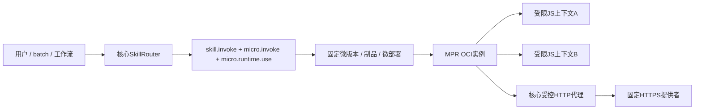

# 微插件、核心对象与共享运行时

[架构目录](README.md) · [领域对象](domain.md) · [状态机](state-machines.md) · [Skill定义](../skills/definition.md)

> 规格版本：2.8.0；状态：待实现的规范。本文描述核心扩展和运行时契约，不表示已有JS执行或外部搜索服务。

## 普通插件与微插件

普通Plugin以独立OCI制品安装，Deployment/Instance负责其容器、资源、工作负载身份及生命周期。微插件是核心独立管理的轻量业务对象，没有自己的OCI镜像、容器或实例证书。

Micro Plugin Runtime（MPR）本身是普通OCI预设`org.xelab.micro-plugin-runtime@1.3.0`。一个MPR实例可为多个微部署建立独立短命worker/受限JS上下文；各微部署固定父运行时部署和安装，不在调用时寻找任意可用解释器。

## 核心对象

| 对象 | 保存内容 | 不变量 |
|---|---|---|
| MicroPlugin | UUID、owner、name、status | 独立资源类型micro_plugin；默认私有，按具体UUID授权 |
| MicroPluginVersion | UUID、MicroManifest、package_digest、source_digest、runtime_installation_id | 发布后不可变；源码、Schema及运行时安装变化发布新版本 |
| MicroDeployment | UUID、owner、micro_version_id、runtime_deployment_id、enabled、limits、resources、network_enabled、phase、candidate_skill | 原版本/limits/父绑定固定；停用排空后可手改资源/联网设置，不改候选Skill |
| HttpBinding | 微部署、endpoint_alias、secret引用、priority、enabled、timeout_ms及revision | 核心持有密钥引用；绑定只能使用微版本已声明的endpoint，VM不见secret ID或值 |
| 准备句柄 | MPR实例/代次、微版本/部署、制品摘要及运行状态 | 可丢弃重建，不是授权、制品或持久版本ID |

普通Installation只表示MPR镜像安装；它不表示后来发布的微源码受该镜像签名覆盖。微制品由核心按当前授权所有者及包/源码摘要单独登记，历史发布来源随版本保留。

## 发布、部署与Skill

1. 创建MicroPlugin时确定可信owner，不接受调用方冒充其他账户。
2. 发布版本时验证MicroManifest、源码、包摘要、输入/输出Schema和精确runtime_installation_id，保存不可变版本；此时不产生尚未绑定微部署的Skill。
3. 创建MicroDeployment，核对父部署micro.runtime.use和实际安装，固定微版本、runtime_deployment_id及limits后生成deployment.candidate_skill；初始enabled=false、phase=disabled。
4. registerSkill验证候选及来源权限；CreateSkill.installation_id必须为同一MPR安装。SkillTarget.kind=micro固定micro_version_id、package_digest和micro_deployment_id，plugin_id固定实际绑定运行时安装的plugin_id（官方预设为org.xelab.micro-plugin-runtime）。
5. 显式启用微部署和注册后的Skill；只有当前审批、父运行时健康和Prepare都满足时才可调用。

Skill的input_schema/output_schema直接来自不可变MicroManifest，mapping=identity。用户请求只包含业务JSON；微版本、制品、部署和控制句柄均由核心读取定义后构造，不嵌入可由业务字段覆盖的任意执行目标。

候选名为org.xelab.micro-plugin-runtime.micro.<micro_deployment_uuid>.run，版本为MicroManifest.version，超时固定为该微部署limits允许值。更换原limits或父运行时绑定须新建微部署和候选；停用排空后调整resources/network_enabled不改变版本/Schema/包摘要或候选定义。

微对象的发布记录和候选来源由核心验证；候选不能随意更改目标或Schema后仍借原包摘要注册。MPR升级到另一安装时，需显式发布/迁移微版本和Skill，不把旧版本自动绑定到新版解释器。

## Prepare、Invoke与Release

MicroRuntimeService只接收内核mTLS调用。Prepare验证固定微版本、包/源码摘要、微部署、Schema和受限引擎条件，建立当前实例代次句柄；重复准备同一精确目标可幂等复用。运行时重启后核心按固定版本重新准备。

Prepare/Ready不要求出网。network_enabled默认false，pure照常调用；controlled-http-v1业务Invoke在关闭状态于创建worker前返回PERMISSION_DENIED，violations.field=network_enabled，不占HTTPsequence、不触发服务商fallback。

Invoke携带内核生成的可信微目标及业务input，要求与已准备句柄一致；核心和MPR均校验输入/输出Schema、期限和取消状态。成功只提交完整合法JSON结果。错误码和消息结构以机器RPC契约及预设接口为准，不能从stderr文本推断成功或副作用。

Release停止接纳该句柄的新执行并清理准备状态，重复清理或对象已不存在可幂等完成。Cancel/QueryResult复用CapabilityService，MPR的Describe/Initialize/Health/Drain/Shutdown复用普通PluginLifecycle。

用户无直接访问上述微运行时控制入口的路由。裸能力调用、HostService.Invoke或工作流裸contract不能绕过micro Skill和具体微对象权限。

## 执行profile与JSON协议

引擎为受限JavaScript，协议为json-stdio-v1，单次接收一份JSON输入并产生一份JSON输出，无流式业务输出。MicroManifest.execution_profile缺省解释为pure-json-v1；已有纯计算制品不通过回写默认字段重新打包，其source/package摘要保持不变。

| profile | 版本约束 | 执行能力与期限 |
|---|---|---|
| pure-json-v1 | side_effect=none，http_endpoints缺省或空 | 纯JSON计算，默认2s；无HTTP桥 |
| controlled-http-v1 | side_effect=non_repeatable，声明1..8个不可变http_endpoints | 监督器桥接至核心固定HTTP代理，总deadline最多15s、最多3次HTTP请求、单次最多4s |

每个endpoint固定alias、origin、path、method、auth_header/auth_scheme和payload_schema。origin只允许HTTPS443，方法为GET或POST；业务input不能覆盖地址、路径、方法、鉴权模板或新增endpoint。每个微部署的endpoint_alias绑定唯一。新增宿主能力必须发布新微版本/包摘要并显式部署审批，普通MPR升级不自动扩张已有微代码能力。

stdio描述受控输入/输出缓冲，不授予宿主文件描述符或进程能力。两个profile均无文件、Blob、真实fetch/socket、secret原值、直接HostService或任意Python/Node/shell入口。HTTP profile只增加host.httpBindings()/host.httpRequest(...)受控桥及声明式host.fail(...)；监督器持有RPC上下文，VM仍不能读取实例证书或委托句柄。

每个业务Call由核心冻结enabled HttpBinding的有序快照，按priority和UUID稳定排序。VM只得到alias、priority、timeout_ms投影；secret引用/版本及固定endpoint控制字段留在核心。快照不冻结撤权，禁用/删除绑定、secret撤销及微权限失效逐次检查，旧Call不得因配置变化静默换key。

监督器以HostService.ProxyHttp发送call_id、alias、sequence和有摘要的payload。核心从实际RpcDelegation推导MPR/微调用，联合检查调用者micro.http.request、原微执行权限、已批准绑定限定的内部secret.use和父MPR的micro.http.request/egress审批后才注入凭证。调用者不因此取得LeaseSecret权，原值也不交给MPR或VM；响应不含headers/Cookie，2xx JSON回显原凭证时拒绝返回。

核心持久台账以(call_id,sequence)去重，同指纹重放原结果、异内容冲突；sequence为1..3，每alias最多一次真实请求，同一Call只允许一个在途HTTP。实际已发送但结果不能确定时sticky unknown，禁止后续sequence和自动重跑脚本；已确认的预发送失败或上游429/5xx/鉴权拒绝可由脚本在同一Call明确fallback，平台授权失败不能当作备用条件。

MicroManifest.business_errors可选声明业务code、http_status及retryable；受控VM的host.fail只能选该清单，产生MicroInvokeResponse.error。业务状态只允许400/409/413/429/502/503/504，不能声明平台保留码或401/403。代理台账unknown优先于业务失败或stdout，核心固定为UPSTREAM_OUTCOME_UNKNOWN/409，不伪装成功JSON。

MPR执行引擎实施heap/stack、超时与上下文隔离；每次JS执行在独立短命worker内。核心受审OCI适配器另管理父MPR的control/workloads及每微部署子cgroup，真实限制该部署全部worker的合计CPU带宽和计量内存；不是为每次调用创建OCI容器。引擎、监督器及适配器共同属于可信执行基础。

## 两级预算与权限

resources默认memory_bytes=268435456、cpu_millis=250：256M按256MiB解释，0.25vCPU按250m时间带宽解释，是一个MicroDeployment所有活动worker的共享上限。原单调用heap/stack/输入输出limits继续生效；其可计量预算乘允许并发不得超过组memory，native开销还受hardmax和实测约束。

先取得父MPR槽及workloads容量，再激活对应微部署资源组/活动槽；首个worker激活只计一次完整resources，后续同组worker不复制整份资源，最后退出且清理确认后释放。默认父4C4GiB，control为缓存256MiB+控制128MiB/500m，workloads为3584MiB/3500m；默认资源下最多4个不同微部署各1个Call活跃，仍以实例4槽为并发上限，不因父容量更大放宽。

监督器先创建不加载用户代码的停等worker，再携当前Call委托、核心group不透明句柄、容器PID/启动时间调用HostService.AttachMicroWorker。核心核实namespace/start-time/pidfd和父实例归属，迁入正确子组成功Ack后才执行JS；失败终止回收。核心Runtime提供ensure_micro_pool/configure_micro_group/attach_micro_worker/release_micro_group，MPR不获privileged或宿主cgroup写权。

缺失可靠cpu/memory控制、入组、group kill或回收时阻止Ready。子组OOM可影响同一微部署多个Call，已发HTTP按原unknown证据处理；父实例整体故障仍是所有微部署共享的风险。worker地址空间上限1GiB仅限虚拟空间，不作为每worker RSS预留。

微部署不建立额外OCI实例，不重复申请节点插件池预留，也不借用内核至少4C16G。多个微对象不能各自复制父部署预算；增大微限额不自动扩容MPR。

## 手动资源与联网设置

PUT /api/platform/v1/micro-deployments/{id}/settings携If-Match与Idempotency-Key完整提交{resources:{cpu_millis,memory_bytes},network_enabled}。仅enabled=false、phase=disabled且已排空worker（含启动/Attach）、Prepare和queued时可改；其余STATE_CONFLICT，同值无副作用。

变更验证父池/审批及组内可计量并发预算，推进revision/generation、失效旧句柄，再启用/Prepare；原limits、版本和父绑定不变。network_enabled=true只允许controlled-http-v1，并不取代微HTTP权限、HttpBinding/secret或egress检查；ProxyHttp还逐次复核当前开关、enabled和原generation防竞态。

停用先原子enabled=false/generation++撤路由、phase=draining；取消队列/Prepare/worker/句柄并清理资源组后才disabled。清理失败保持draining/failed，不能改settings，不将“期望已关”当作执行资源已排空。

创建微部署及每次执行都检查父runtime_deployment_id上的micro.runtime.use；执行还要检查skill.invoke、micro.invoke（具体micro_plugin UUID）、父MPR当前审批、安装绑定和完整授权链。HTTP调用另需micro.http.request及当前HttpBinding/secret/egress准入；绑定管理需micro.http.bind，创建或更换secret还需secret.bind。子账户/Key和同实例关系不产生隐式共享，脚本也不能继承MPR自身HostService能力。

## 故障、停用和恢复

MPR未安装、停用、离线或代次变化时，关联微部署进入waiting_runtime，旧准备句柄及新调用路由失效；核心管理API和CLI继续Ready。恢复后仅为同一固定父部署/安装重新Prepare，不能自动改用其他MPR或同名微版本。

微部署停用经draining及完整回收后收敛到disabled，微部署或MicroPlugin归档最终为archived；先撤新路由、取消在途执行，再Release句柄/资源组。已发HTTP不能因取消被宣称撤回，证据不足保留unknown；不能以清理超时重新开放路由或允许settings。历史版本、Call及审计证据继续保留。

batch/工作流继续固定原微Skill、版本、制品和微部署，父运行时不可用时等待原依赖。纯profile安全重算仍保留原定义、输入、业务键和deadline；HTTP profile按non_repeatable处理，不自动换attempt重跑未知外部请求。归档及权限失效按取消/授权暂停规则收敛。HTTP执行细则见[MPR协议](../preset-plugins/micro-plugin-runtime/execution.md)。

## 微插件作为扩展宿主

MicroPlugin可通过不可变版本显式声明extension_points，作为Extension Plugin宿主；没有声明的旧版本不支持扩展，不为补字段重写原包摘要。扩展宿主也可以继续接受扩展，所有宿主与处理器边进入同一DAG和16层限制。通用对象及控制路径见[扩展插件](extension-plugins.md)。

MPR1.3须显式支持受审扩展适配：mode=data提供只读、有界extensionData，贡献只含严格JSON，不允许载入任意JS/native模块。微调用的输入/输出Schema、副作用、heap/stack及资源边界仍来自原MicroManifest；扩展不能替换代码、增加HTTP桥或把network_enabled=false变成联网。

mode=skill的固定处理器由监督器通过HostService.InvokeSkill交给核心复核，VM不获得HostService客户端、凭证或任意目标。核心联合检查调用者完整权限链、handler Schema/副作用、固定依赖和原微profile/网络限制。处理器在独立服务执行时按该服务原资源计账；根微执行仍聚合计入原250mCPU/256MiB微资源组及MPR父4C/4GiB，不能沿扩展链复制资源。
