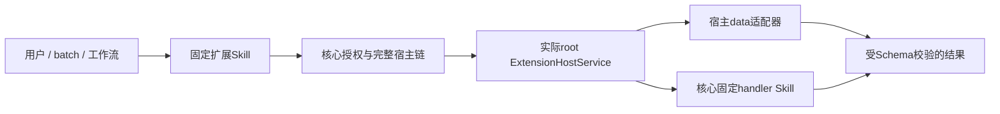

# 扩展执行、公共Skill与资源

[扩展目录](README.md) · [宿主与绑定](hosts.md) · [安全](security.md) · [异步batch](../skills/batches.md)

> 规格版本：2.8.0；状态：待实现的执行契约。data与skill均产生符合扩展点Schema的完整业务结果。

## 核心转发路径

用户输入只包含业务JSON。核心从已注册Skill读取extension_version_id、extension_deployment_id、package_digest及host_chain_digest，核验不可变链后构造控制请求；业务字段不能选择处理器、替换版本、覆盖身份或附带新代码。

创建扩展部署后生成candidate_skill，默认不注册、不启用。候选输入/输出、流与副作用从固定宿主点契约推导，target.kind=extension并固定上述扩展身份和链摘要。CreateSkill.installation_id等于实际物理rootOCI安装，来源仍独立记录扩展版本，不能冒充宿主镜像内的候选。

data与skill候选均可独立注册。它们不修改宿主已发布Skill的名称、Schema、超时、副作用或输入映射，也不能把宿主同名旧入口静默改成另一个处理器。

## Prepare、Invoke与Release

ExtensionHostService只接受内核可信控制请求，实际连接对象是物理rootOCI实例。Prepare携带核心构造的typed host、完整链、固定贡献和配置，验证逻辑closure_digest、当前runtime_snapshot和受审宿主协议后产生短命准备句柄；不能在准备阶段执行业务副作用。

Invoke同时核对准备句柄、根实例/每层部署代次、固定版本/摘要、业务Schema、当前权限及剩余deadline。核心和宿主都校验完整输出；失败、超限、取消或非法部分JSON不能被包装为成功。

Release幂等停止接纳对应句柄的新调用并释放准备状态；它不是删除扩展版本，也不证明外部副作用已撤销。取消与结果核实复用核心Call机制，旧代次的迟到响应不得覆盖新执行。

准备句柄和宿主链摘要都不是授权凭证。缓存命中不跳过当前检查，控制请求也不能来自普通插件自报的用户身份或用户直连入口。

## data模式

contribution.json由固定宿主点的数据适配器解释，并与获授权的业务输入组合执行该点业务。适配器只支持其版本声明的有界语法；不得eval字符串、加载模块、执行命令或将用户路径当宿主文件名。

对于微宿主，MPR1.3向明确声明扩展点的微版本提供只读`host.extensionData(point_id)`投影。它只返回本次固定点、链与贡献允许的JSON，不能枚举其他用户扩展或获得Secret、URL代理、文件、进程、原始HostService。

只读投影是微版本显式选择的宿主协议，不能因MPR升级自动注入旧微VM。data点仍遵守该微业务原input/output Schema、side_effect、resources、network设置及Attach执行边界。

## skill模式

宿主监督器只调用扩展清单固定的handler_skill_id及handler_definition_digest，通过HostService.InvokeSkill转交核心。核心核对处理器定义与点契约的输入、输出、期限及副作用兼容，按真实处理器及完整来源链重新授权；定义消失或摘要不符时不可用，不按名字查找替代实现。

处理器可以是普通、微或扩展Skill，但不能突破任一祖先点、微profile或网络限制。微VM仍没有HostService客户端；监督器的固定转发不意味着脚本可以选择任意子Skill或继承父工作负载的代理权限。

输入采用固定契约映射，不从contribution或业务JSON中读取一个新Skill ID执行。若需要不同处理器或映射，必须发布新扩展版本/部署及候选Skill，而不是原地改绑定。

## 资源与副作用

扩展加载、贡献解码和宿主适配开销计入实际执行根。扩展链不创建额外OCI、不按层复制节点预算，也不按扩展数量复制微部署250mCPU/256MiB。微根仍使用同一聚合cgroup与worker Attach规则，所有加载、校验、处理和等待时间计原deadline。

MPR父容器默认4vCPU/4GiB，微部署默认250mCPU/256MiB、联网关闭；提高链深或引用处理器不扩大额度。独立handler服务仍按其原部署/微资源组正常准入和计量，不能把一次子调用的资源当成无成本宿主内存。

扩展点契约必须预先覆盖允许的最大副作用，下层处理器不能比任一祖先承诺更强。非重复安全的外部请求发生后，断线、OOM或取消按证据保持unknown；不得换扩展、换处理器或从链头盲重跑。

多项处理使用核心异步batch，逐项执行固定扩展Skill并查询结果；单项还受点与实际根的输入输出/资源预算约束。整批不提供原子事务，恢复时不得让已冻结的扩展集合随当前安装状态漂移。

## MPR1.3只读数据接口

`host.extensionData(point_id)`仅在已声明该data点且当前ExtensionHostService.Invoke固定了贡献链时，返回该点的只读记录数组；每项为`{contribution,config,children}`，children为子point_id到同形记录数组的对象。只包含当前已授权固定链，按priority/UUID稳定排序；不枚举未授权或其他已安装扩展，不含凭证/委托。代码获得不可影响核心状态的副本。

完整投影UTF8 JSON≤1MiB、深度≤64，并计入原VM heap及微组内存；越限整项失败，不通过桥绕过预算。未声明point拒绝；普通MicroRuntimeService.Invoke没有扩展快照时对已声明data点返回空数组，不自动加载当前所有扩展。旧无点微版本没有该接口。

skill模式的处理器接收原业务input，必须与point.input_schema精确相符；contribution/config仅供宿主点适配器使用，不偷偷拼接到处理器输入。监督器通过核心固定Skill执行，目标动作/副作用与原micro profile逐项检查，VM仍不能调用HostService。
