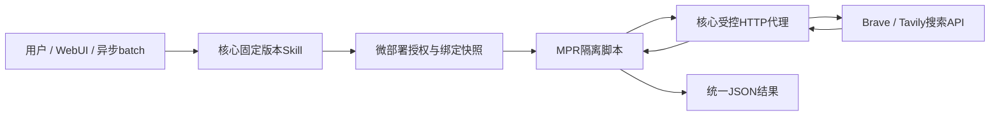

# 网页搜索微插件

[预设目录](../README.md) · [业务Skill](../../skills/web-search/README.md) · [微插件架构](../../architecture/micro-plugins.md)

> 规格版本：2.6.0；状态：待实现的预设设计，尚无可运行制品或上游兼容性实测。

预设ID为`org.xelab.web-search`，微版本为`1.0.0`，目录类型为`micro`。它依赖已安装、获批且支持`controlled-http-v1`的[Micro Plugin Runtime](../micro-plugin-runtime/README.md)，自身没有OCI镜像、容器、数据卷或单独的容器生命周期。

网页搜索仅转发受控第三方搜索API，把服务商结果转换为统一的标题、URL和摘要列表。按用户授权配置的服务商优先级串行调用，并在明确允许的失败条件下fallback。它不抓取结果网页，不生成答案，不下载图片，也不返回网页原文。

## 调用路径

脚本只能用`host.httpBindings()`读取本次调用的非敏感绑定投影，再用`host.httpRequest(alias,payload,seq)`发起声明过的操作。代理固定HTTPS目标、方法、路径和认证头；脚本、MPR、调用输入和输出均不接触Secret原值。

## 制品与部署

| 项目 | 规范值 |
|---|---|
| 预设ID | `org.xelab.web-search` |
| 目录类型 | `micro` |
| 微版本 | `1.0.0` |
| engine / protocol | `javascript` / `json-stdio-v1` |
| execution_profile | `controlled-http-v1` |
| side_effect | `non_repeatable` |
| 普通配置 | defaults.schema.json只接受空对象`{}`；服务商配置由核心HttpBinding管理 |
| 不可变HTTP端点 | `brave`、`tavily`，见[适配器](providers.md) |
| 持久卷 / 独立实例 | 无 / 无，复用父MPR的资源与活动槽 |

安装预设的流程是创建微对象、发布核验摘要的不可变版本、选择实际Runtime创建MicroDeployment，然后配置和审批HttpBinding。MicroDeployment初始`enabled=false`；创建后才由核心生成`candidate_skill`，随后按正常流程注册和启用。

发布微版本不会生成Skill；不能从预设ID推导出一个已注册的固定Skill UUID，也不能附带一个可绕过微部署的静态execute Skill。不同微部署的候选Skill绑定各自的微部署UUID、微版本和package_digest。

## 资源与外部费用

单微部署模板默认并发1，硬上限4，同时受父MPR总活动4的限制。总期限15000ms覆盖排队、准备、脚本和全部HTTP尝试；单次HTTP最多4000ms，最多三个串行attempt。

heap默认16MiB、stack 1MiB，输入和输出各最多1MiB，stderr最多64KiB。代理每attempt的请求最多64KiB、解压后的响应最多512KiB。配置与[执行协议](execution.md)中的更低限制优先。

外部搜索可能收费，因此`non_repeatable`约束核心和Broker恢复。已发送后结果不明时进入`unknown`，不能把同一次查询自动重发到另一个服务商。取消本地Call不能撤销已发送的外部请求或保证退费。

资源从父MPR所在插件池扣除，不给微插件重复分配一份MPR资源，也不借用内核至少4C16G的预留。本预设的资源数值为待测建议。

## 文档

- [用户配置、HttpBinding与资源](configuration.md)
- [固定服务商适配器](providers.md)
- [执行、fallback与恢复](execution.md)
- [业务Skill输入输出](../../skills/web-search/README.md)
- [验收条件](acceptance.md)

批量搜索使用[核心异步Skill batch](../../skills/batches.md)。每项仍是一份完整查询输入；未知计费结果不能因批任务重试而自动重放。

[微清单](micro-manifest.json) · [JS转发样例](main.js) · [源码/包摘要](artifact.json) · [发布请求](publish-version.example.json) · [微部署模板](micro-deployment.template.json) · [绑定样例](http-bindings.example.json) · [候选Skill样例](search.skill.example.json) · [调用样例](invoke.example.json)。样例UUID需替换，绑定默认disabled，静态样例不代表已安装/授权。
