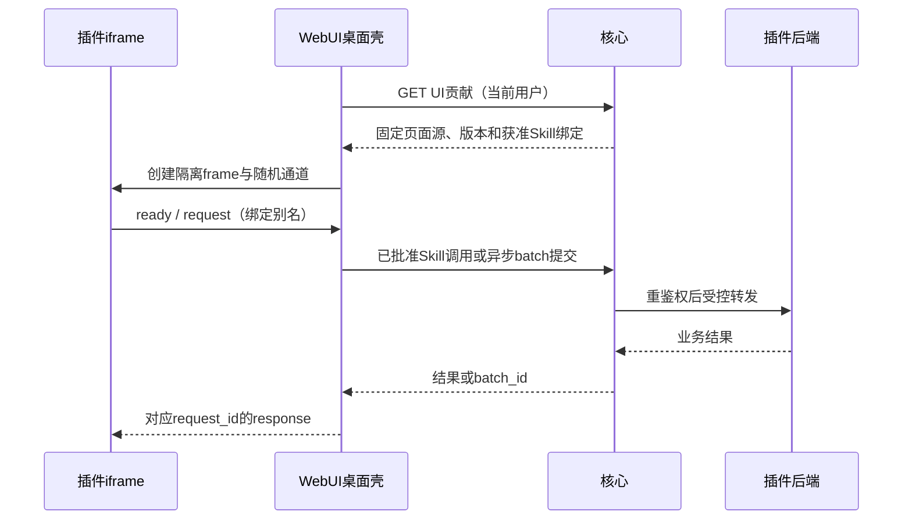

# 插件页面接入与生命周期

[WebUI目录](README.md) · [开发者规范](../../plugins/ui-contributions.md) · [消息桥](../../communication/ui-bridge.md)

> 规格版本：2.8.0；状态：待实现的规范。

插件开发者可以只实现业务Skill；需要图形界面时，在签名Manifest.ui添加window/widget贡献与静态路由。窗口的iframe模拟应用内容区，组件的iframe显示在桌面网格，两者使用同一协议。

宿主用getUiContribution核对安装/贡献摘要后加载frame_url；只信任bindings中的精确Skill UUID/digest/modes，不按页面自报的名称“查最新”。白名单缺失时返回BINDING_UNAVAILABLE，页面显示原因。

每个挂载生成新view_id与256bit channel_nonce，fragment只含桥路由元数据和parent_origin，不包含身份令牌。iframe加载后10s内握手，核心令牌永远由壳/BFF持有，不发送给页面。

核心身份/授权、Skill注册/调用、batch和UI发现/偏好由核心实现；菜单、Dock、窗口、组件调度、消息适配与主题渲染由WebUI实现；插件负责页面内容、声明的Skill和按令牌更新自身样式。父页面桥白名单不能代替后端授权。

部署停用/实例不健康：撤销新桥请求，页面显示unavailable，已接受batch由核心管理。用户撤权/退出：销毁所有桥上下文和私有显示，不向其他用户复用view_id。

部署升级：固定贡献摘要发生变化则停止旧frame的新请求，要求显式重载并重新发现/握手；不能让旧页面自动继承新增绑定。失败页面可由壳重试，但重试页面加载不等于重试已有副作用操作。

同一WebUI可承载多个插件；业务插件自己的窗口/组件页面不要求与默认WebUI使用相同框架。前端只依赖JSON消息协议，不能依赖桌面壳内部React/Vue或全局对象。
