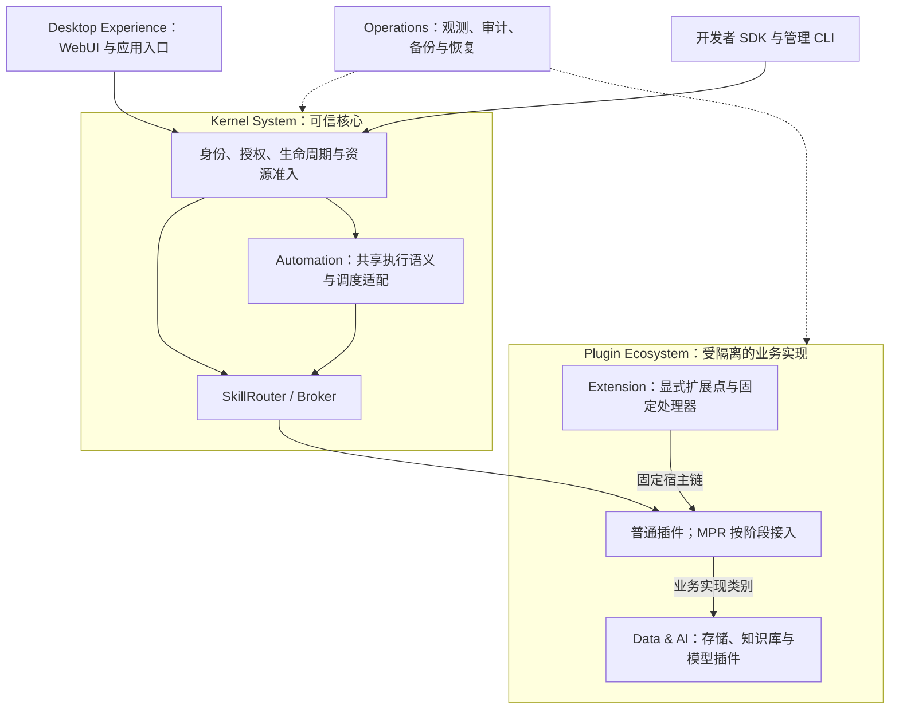

# XeLab 3.0 产品架构与演进规划

> 状态：规划建议，尚未实施，不替代 2.8.0 规范。审阅日期：2026-10-30。基线：`jyxxe/XeLab` 的 `main`，提交 [`5a4b7911b044e8b9736e6f805a5efa87a202b6d5`](https://github.com/jyxxe/XeLab/commit/5a4b7911b044e8b9736e6f805a5efa87a202b6d5)。本次仅新增本文件，不变更 API、Proto、Schema、数据库或现行规范。

## 1. 产品愿景与定位

XeLab 面向自托管用户与插件开发者，成为**以稳定 Skill 为组合入口、以插件承载业务、以核心保障权限与可靠执行的单节点应用和自动化平台**。

3.0 的首要成果是一个可安装、可开发、可排障、可恢复的运行产品。用户应能完成“安装一个插件 → 明确授权 → 调用或批量执行 Skill → 查看结果 → 安全升级或恢复”；开发者应能不改内核接入第二个独立实现，并为明确支持扩展的宿主发布贡献。

“应用”先表示固定插件部署、Skill、可选工作流和 UI 入口的组合，不新增一套 Application 运行时、授权体系或应用包格式。组合先用经过验证的安装说明与示例表达；以后确有重复安装需求，再设计版本化组合清单。

3.0 相对当前设计的核心变化只有五项：**收紧首发能力集、提前开发者工具、分层交付 Extension、复用执行与数据通道、以恢复和兼容测试约束发布**。功能数量、桌面拟真程度和预设数量不作为发布目标。

## 2. 现有架构评估

### 2.1 实现状态与证据边界

根 README、文档总目录和实施路线图均明确声明：**当前仓库尚未包含平台实现**。因此不存在可据本次审阅确认的“已运行 2.8 平台”；3.0 首先是将既有规范变为产品，而非从一个已验证运行版本直接升级。[S1][S2]

| 类别 | 本次可确认的内容 | 不能据此宣称 |
|---|---|---|
| 已存在的仓库成果 | 2.8.0 架构文档、机器契约、示例、文档校验工具；最新提交记录了结构校验结果 | 已有内核服务、容器镜像、SDK、CLI 二进制或性能数据；本次也未重新运行原校验工具 |
| 已设计、待实现 | 身份与授权、OCI、MPR、Extension、Skill、Batch、Workflow、Schedule、Event、WebUI、对象存储、知识库、模型预设及运维流程 | 规范中的 MUST、默认资源值和验收条目已经实现或通过实测 |
| 更远期的已有规划 | 12 个普通插件、20 个微插件及其能力草案、落地门槛 | 已注册预设、现成 Connector 市场或可直接交付的功能 |
| 本文新增规划 | 首发范围及发布门槛、SDK 前移、扩展宿主支持顺序、开发者参考工程、Workspace 轻量定位、按能力报告实现状态 | 新的 API、数据库实体、协议字段或立即可用功能 |

审阅仅覆盖入口文档、指定路线图/验收，以及架构、Extension、运行资源、任务、WebUI、数据预设和运维的相关专题；未扫描全部文件，也未逐项审计 189 个 HTTP 操作或 227 个模型。下列判断是架构与交付评估，不是运行时安全认证。

### 2.2 保留与调整

| 设计 | 决策及原因 |
|---|---|
| Rust 微内核、单节点 Linux、OCI、PostgreSQL/outbox、CPU 范围 | **保留。** 不为 3.0 引入外部消息队列、分布式调度或新的服务框架。[S3] |
| 身份/授权集中决策，安装/部署/实例分离，固定版本与摘要 | **保留。** 这是隔离、追责和可恢复执行的基础，不能以缩小 MVP 为由省略。[S3][S9] |
| SkillRouter/Broker、受控 Blob/Secret、租约/fence、unknown | **保留。** 统一业务入口和执行语义；不承诺外部副作用恰好一次。[S5][S8] |
| 普通、微、扩展三类插件，显式版本化扩展点 | **保留模型，调整交付顺序。** 先普通宿主 data，再固定 handler；MPR 与递归链单独设门槛。[S4] |
| 现有 M1–M6 路线图 | **调整实施顺序，不改写原文。** SDK/CLI/契约测试从 M6 前移；故障恢复与备份伴随内核开发；M5 中知识库与模型拆分。[S2] |
| 全量桌面、三种模型及大量预设同时落地 | **缩减首发。** 首先交付管理与执行体验；用少数真实插件验证扩展性，避免生态规模先于生态工具。[S6][S7] |
| 4 vCPU/16 GiB 内核预留与 MPR 默认资源 | **保持现行约束，增加实测。** 这些不是常驻用量或整机最低配置；不能未经测量自行降配。启用默认 MPR 后两者合计已达 8 vCPU/20 GiB，尚需宿主与其他插件预算。[S3][S7] |

## 3. 3.0 总体架构

以下为职责视图，不表示全部能力都会在 3.0 首发启用。

| 归属 | 必须承担 | 不应承担 |
|---|---|---|
| 核心及受审宿主适配器 | 身份与最终授权；制品验证；生命周期/依赖；资源准入；Skill 路由；共享执行语义；Blob/Secret 授权；扩展链校验；恢复控制 | 解析文档、业务数据库查询、模型推理、主题渲染、任意业务脚本 |
| 普通插件 | 有独立资源或状态的业务、Connector、对象存储、知识库、模型；WebUI 和 MPR 也是普通受管插件 | 直接访问核心数据库、运行时 socket，或成为绕过核心授权的入口 |
| 微插件 | 固定 MPR 中的有界纯 JSON 计算；先以离线、无副作用能力验证价值 | 任意 Node/Python 依赖、shell、文件读写、非受控网络；不为每个微插件建立 OCI |
| Extension Plugin | 宿主已实现语法下的映射、规则、模板等 data 贡献；随后是固定 Skill handler | 通用运行环境、任意 JS/native 注入、继承宿主权限、隐式获得 UI 来源 |
| WebUI | 导航、管理表单、任务视图、个人工作区与隔离 iframe 的呈现 | 最终授权、保存控制数据库、直接执行插件代码或把隐藏按钮当权限控制 |
| 运维基础设施 | PostgreSQL、containerd、出口/卷适配、日志后端及宿主外备份目标 | 可由普通用户随意停用的业务插件；同机多副本不算宿主高可用 |

Automation 的“统一”是复用授权、固定目标、deadline、取消、幂等、租约、fence 和结果核实实现，**不合并既有 Call、Task、Batch、Operation 的对象与数据库结构**。Data 的“统一”是复用身份、Skill、Blob/Secret 和数据引用，不强迫所有插件共用业务数据库。[S3][S5][S7]

## 4. 六大子系统演进规划

以下编号用于排期与验收追踪；P0/P1/P2 的发布含义见第 5 节。验收均为未来实现要求。

### 4.1 Kernel System

| 改进 | 目的与设计方向 | 依赖条件 | 验收标准 |
|---|---|---|---|
| **K1 · P0：可运行的核心与可信调用** | 将 M1 转为首个纵向闭环：账户/凭证链、授权、签名安装、部署/实例、Skill 到普通插件。建立逐 operationId 的实现状态表；未实现能力明确拒绝，不返回空成功。 | 2.8 契约、PostgreSQL、受审 OCI 适配器、最小开发者工具 E1。 | 两个独立实现复用同一契约且不改核心；AUTH-01～09 通过；无权用户、已撤销凭证及错误摘要不能调用；未实现项无成功响应。 |
| **K2 · P0：可靠运行与资源准入** | 落实预留/创建/对账、卷硬配额、受控 Blob/Secret、出口默认拒绝；容量不足显式等待或拒绝。管理面与插件故障隔离。 | K1；cgroups v2、卷配额与网络前提启动自检；宿主预算明确计量。 | RUN-01～07 通过；DB 提交与 OCI 创建两侧崩溃均无重复预留；OOM/卷满不越界；新旧并行容量不足不借内核预算；WebUI 失败后 CLI 可用。 |

资源调度维持单节点准入与有界队列，不新增跨节点调度器。启动检查不能只检测配置字段存在，必须验证实际硬隔离；不满足时阻止相应服务 Ready。

### 4.2 Plugin Ecosystem

| 改进 | 目的与设计方向 | 依赖条件 | 验收标准 |
|---|---|---|---|
| **E1 · P0：开发者最小闭环** | SDK、CLI 与参考工程随内核开发：优先维护一套 Rust SDK，复用 Proto 支持其他语言；提供普通插件模板、签名打包、Schema/契约测试、安装诊断与本地集成流程。开发辅助命令是工具规划，不冒充已有 xelabctl 命令。 | K1 同步迭代；既有 CLI、制品和版本规则。 | 干净环境按文档完成构建、打包、安装、Skill 调用和卸载；另一语言独立实现通过同套测试；CI 拒绝摘要不符、越权请求、错误输出和不兼容契约；发布者可读懂失败原因。 |
| **E2 · P0：普通宿主的 data 扩展** | 先交付普通宿主单层、严格 JSON 的 data 扩展；独立身份/版本/部署、候选 Skill 与逐层权限保持完整。用一个字段映射或格式规则参考宿主证明无需改核心扩展业务。 | K1/K2、E1、固定 Skill；宿主真实实现 ExtensionHostService 与版本化扩展点。 | 发布→绑定→注册/启用候选→调用→停用完整走通；EXT-01～04、06～10 的适用用例通过；旧无扩展点宿主拒绝绑定；数据超过 256 KiB、可执行贡献、跨类型环均拒绝；宿主先 Ready，扩展失败不拖垮无关能力。 |
| **E3 · P1：固定 Skill handler** | 在 data 闭环后增加 ordinary 宿主的 skill 模式，复用核心 HostService/SkillRouter；不由宿主自行按名称选处理器。继续保持单层公开支持范围。 | E2、A1；宿主代理审批、处理器契约及副作用说明、完整依赖图校验。 | handler ID/definition_digest 固定；撤销任一主体/宿主/handler 权限后拒绝后续调用；不能放大副作用或期限；处理器重启后未知结果不重放；根与独立 handler 分别正确计量。 |
| **E4 · P1：受限微插件试点** | 仅纳入少量 pure-json-v1 转换示例，先验证开发成本与隔离；MPR 可选安装，不成为核心 Ready 或普通扩展的前置。 | K2、E1/A1；AttachMicroWorker 与真实逐微 cgroup；父池、worker 和内存预算实测。 | Ack 入组前不执行代码；同一微部署全部 worker 合计受限；默认网络关闭；资源设置仅在停用排空后调整；父重启使旧句柄失效，恢复固定制品；MPR 离线不阻塞核心。 |

**3.0 不宣称完整 Extension 2.8 兼容实现。** 对外明确列出已验证的宿主类型与模式；micro 宿主、extension 宿主及多层链执行列为 P2。解析和拒绝逻辑仍须覆盖跨类型环及深度边界，不能因为暂不支持执行而放松校验。后续完整实现沿用既有最多 16 层约束；任何不支持的组合须在创建/准备阶段拒绝，不产生半份绑定。[S4]

生态建设先有参考工程、兼容测试、可追溯制品与人工审核流程；在线市场、评级、付费分发不作为 3.0 前置。

### 4.3 Automation Engine

| 改进 | 目的与设计方向 | 依赖条件 | 验收标准 |
|---|---|---|---|
| **A1 · P0：Skill 与 Batch 的可靠执行底座** | 先打通单次调用与持久批次；共享 Broker/授权/固定委托及恢复机制，保持各自状态模型。每次重试只有一个决策者；管理 Operation 不承载业务批次。 | K1/K2；有界 Skill；持久输入/结果、配额和审计。 | 关闭页面后已接收批次继续；父级撤权暂停后续项；TASK-01/02、STREAM-01 对应故障通过；non_repeatable 结果不明进入 unknown；旧 fence 不能提交；计数守恒，取消不伪称撤回已发生副作用。 |
| **A2 · P1：手动触发的有限 Workflow** | 复用 A1 的执行实现，增加既有 Workflow DAG 与 input_mapping v1。先提供 3～5 步参考流程和步骤诊断，不开发脚本语言或可视化编程平台。 | A1；固定提供者、输出引用；所有节点 Skill 已验收。 | 既有最多 64 步边界、环/未知依赖/缺失 JSON Pointer 校验通过；中途重启、撤权、取消不跳过授权或重放未知副作用；修改流程不改变已提交任务绑定。 |

Schedule 与面向用户的 Event 订阅/触发自动化列为 **P2**；核心事务 outbox 与恢复所需内部事件仍是 P0 基础设施。后续接入只增加触发适配，不另造执行器：Schedule 依赖 A2 与长期委托，验收 DST、misfire、重叠及唯一触发；Event 依赖持久投递、范围授权、去重与死信，验收至少一次投递和旧租约拒绝。现有 HostService 没有 CreateTask，不能假设插件或 webhook 已能提交任务；缺少的受授权桥接须先独立设计契约。[S5][S10]

### 4.4 Data & AI Platform

| 改进 | 目的与设计方向 | 依赖条件 | 验收标准 |
|---|---|---|---|
| **D1 · P1：最小可用数据链** | 先对象存储，再知识库表/行读写；业务在普通插件，核心仅做授权与受控传输。分清临时 Blob 和持久对象；未选中的知识库查询、缓存、向量操作不发布对应 Skill。 | K2/A1、备份 O1；对象存储与知识库各自完成卷配额、幂等、业务 ACL。 | 临时 Blob 到期后持久对象仍可读；跨用户/子账户访问拒绝，CAS 冲突明确；保留既有单对象 64 MiB 上限；无需 embedding 可完成结构化导入/读取；备份恢复核对对象与行内容。每个已发布操作须完整遵循原语义。 |
| **D2 · P2：Connector 逐个接入** | 以普通插件实现服务商协议，核心复用 Secret、出口批准、配额与 Skill；先一个只读连接器证明边界，再考虑外部写入。 | K2、E1、A1；各 Connector 的来源授权、网络策略和业务契约。 | DNS/重定向/SSRF 与凭证隔离测试通过；无任意 URL/SQL 透传；外部写入须提供幂等或结果核实，未知计费/送达不自动重试；撤权后停止新请求。 |
| **D3 · P2：Model Runtime 与向量增强** | 模型在普通 CPU 插件中，复用既有明确文本/embedding 子集；不新增“统一 AI 内核”。按需求选一个经验证的模型实现，不默认启动全部预设。 | D1；模型/tokenizer/制品锁定、许可与来源核验、实际硬件测量、索引一致性。 | 记录硬件、数据量、吞吐、峰值内存及检索质量；向量维度/模型空间匹配；缺模型时非向量读写可用；不得以换模型静默恢复旧任务或索引。 |

“统一数据平台”不等于让知识库读取对象存储的私有卷，也不等于新增跨插件 SQL。数据经受控 Blob 或明确 Skill 传递；现有每个插件的业务权限不能由 Workspace 名称替代。[S7]

### 4.5 Desktop Experience

| 改进 | 目的与设计方向 | 依赖条件 | 验收标准 |
|---|---|---|---|
| **W1 · P0：以任务为中心的最小 WebUI** | 保留独立 WebUI 插件、可信登录源与公开管理 API。首屏优先安装/依赖/授权状态、Skill 调用、Batch 进度与错误详情；完整桌面动效和多窗口管理后置。 | K1/A1/E2；可用 API 清单、隔离来源与消息桥。 | 安装→授权→调用/批次→定位失败→停用可完成；区分无权、未实现、依赖离线、等待资源与 unknown；键盘完成主要流程，窄屏可用；关闭或卸载 UI 后运行及 CLI 恢复正常。 |
| **W2 · P1：个人 Workspace 与少量 Widget** | Workspace 先是个人导航、固定应用入口与布局偏好，不是新的租户或数据权限域；优先复用现有偏好字段，无法表达的持久化需求延期。Widget 通过普通插件既有 UI contribution/隔离 iframe 接入。 | W1；既有 UI 贡献协议及当前用户授权；刷新/窗口资源有界。 | 切换布局不扩大资源可见范围；伪造 origin/source、过期桥会话与未绑定 Skill 均拒绝；无独立 origin 时贡献 unavailable；隐藏/卸载组件停止刷新，业务 Skill 不受影响。 |

UI Extension 与 Extension Plugin 不混同：3.0 的插件页面由现有 iframe 协议承载；Extension 贡献只能作为经校验的数据由宿主界面呈现，不能注入桌面脚本。扩展专属页面制品、独立来源和加载协议另列 P2，先补明确契约才可启用。[S4][S6]

### 4.6 Operations

| 改进 | 目的与设计方向 | 依赖条件 | 验收标准 |
|---|---|---|---|
| **O1 · P0：可诊断、可备份、可恢复的交付** | 将结构化日志、现有指标、审计、启动自检、备份/恢复和 CLI 救援纳入每阶段；提供单节点安装与升级说明。诊断串起 request/task/operation 与部署来源，输出可行动原因。 | K1/K2；宿主服务、外部备份目标及独立密钥管理；插件一致性备份协议。 | RUN-07、BACKUP-01 与故障矩阵通过；在干净宿主恢复元数据/卷/制品并重建运行状态；已撤销凭证不复活；日志不泄漏 Secret/原始业务内容；DB 不可用时敏感写入不返回假成功。 |

3.0 不承诺高可用或无停机恢复。恢复耗时与数据损失范围由一致性备份点、备份频率、数据规模和实测决定；发布说明记录测试条件及实际 RTO/RPO，不填未经测试的服务等级数字。[S8]

## 5. P0 / P1 / P2 优先级

**P0 是 3.0 首发硬门槛；P1 是 3.0 候选增强，冻结范围时逐项决定，未通过则延期；P2 明确属于 3.1 或更高版本。** 未交付能力保留 2.8 设计，不等于已支持。成本为架构相对估计：中表示多模块接入，高表示涉及隔离/恢复/多控制器；因无运行代码和团队产能基线，不作工期承诺。

| 优先级 | 工作包 | 取舍依据与相对成本 | 依赖顺序 |
|---|---|---|---|
| P0 | K1、K2、E1、O1 | 无运行产品的基础缺口；高。SDK 与观测前移降低后续接入、排障成本。 | 核心与 SDK 同步；隔离/恢复先于业务扩展。 |
| P0 | A1、E2、W1 | 形成“可组合、可扩展、可操作”的首发闭环；高。每类仅一个可验收纵向路径。 | 固定 Skill → Batch/data 扩展 → 最小 UI；安全与恢复随功能验收。 |
| P1 | E3 → A2 → D1 | 优先扩大已验证底座的价值；中至高。按固定处理器、手动流程、持久数据顺序加入。 | 必须使用已通过 P0 的授权、执行及备份能力。 |
| P1 | W2、E4 | 个人体验与微插件开发效率；W2 中、E4 高。MPR 隔离成本较高，最先让出排期。 | 各自门槛独立，不反向阻塞普通插件与核心。 |
| P2 | Schedule/Event 自动化、完整宿主链、D2/D3、扩展专属 UI | 增加长期授权、网络/副作用、资源与兼容组合数；高。等待真实使用需求和前置测试。 | A2/E3/E4/D1 等相关底座稳定后，逐项评审。 |

容量不足时先删除 P1 范围，不能删掉 P0 的授权、硬配额、unknown、备份或兼容测试；若 P0 未完成，只发布明确标注能力范围的预览版，不宣称 3.0 稳定版。

## 6. 分阶段实施路线图

各阶段按退出条件推进，不并行启动全部六个子系统；本节是未来实施顺序，本次不执行开发。

| 阶段 | 范围及与既有里程碑的关系 | 退出条件 |
|---|---|---|
| G0：锁定首发范围 | 在现有 M1–M6 之上建立 P0 实现清单，列 operationId/RPC、宿主模式、测试和负责人；确认硬件/宿主前提与不支持响应。 | 每项 P0 可追溯到契约和测试；依赖无环；区分“设计/实现/已验证”；未补齐的契约问题先决策，不能边写边猜。 |
| G1：开发者可运行闭环 | K1、E1；M1 与 M6 的最小 SDK/CLI 同步，O1 的观测与诊断从首个调用开始。 | 两个独立插件实现可安装、授权、调用与停用；身份负面测试通过；核心无需为第二个实现改动。 |
| G2：可靠的 3.0 预览 | K2、A1、E2、W1、O1；落实 M2、M3 的最小路径及普通 data 扩展。 | 参考扩展、批次和 UI 跑通；宿主重启、插件 OOM、UI 丢失与备份恢复可演示；形成 P0 候选版本。 |
| G3：有条件扩大价值 | 按第 5 节顺序选择 P1；对应 M5 的手动工作流/非向量数据子集；MPR 独立验收。 | 每项有实际使用场景、负责实现的插件、成本上限和独立测试；未达标项退出本次发布，P0 可单独成立。 |
| G4：发布候选与兼容冻结 | 执行全套适用验收、升级/恢复演练和实测；冻结首发能力矩阵。 | P0 全部通过；纳入版本的 P1 同样通过其全部门槛；已知限制、资源数据和恢复步骤明确，方可发布 3.0。 |

对原 M4 的调整是：固定依赖与事务 outbox 按 P0 路径提前落实，面向业务的完整事件投递/触发后置；不把基础恢复也一起延期。对原 M5 的调整是：先执行一致性，再流程与数据，最后模型。M6 的发布审核、兼容验证随交付推进，不等全部功能完成后补做。

## 7. 向后兼容与渐进升级

当前没有经仓库确认的既有运行版本；以下保护的是 **2.8 契约、旧清单/制品和未来发布的客户端**，不声称已完成生产数据迁移。

| 对象 | 兼容策略与验证 |
|---|---|
| 平台版本与协议版本 | 产品 3.0 不自动把 `/api/platform/v1/` 或 Proto v1 改为 v3；插件 SemVer、能力契约版本与平台版本分别管理。支持范围以实测清单明确，不以版本号推导。 |
| 机器契约与语义 | 本文不修改任何契约。后续发现缺口按现行 change-policy 单独设计/评审；同一版本不覆盖 Schema/digest，不改变错误、副作用或权限语义。未来破坏性变更另开主版本并说明迁移窗口。 |
| 普通插件与 Skill | 保留旧插件默认 direct 的兼容调用；显式 skill_required 的业务不能借裸调用绕过。缺扩展点的旧清单保持不支持扩展，不回填或重算原签名。 |
| 微插件与扩展 | 旧 pure 制品不因新 profile 自动联网；MPR 按能力协商，缺真实隔离则拒绝微执行。升级扩展版本、宿主、config 或 limits 创建新部署/候选；不原地覆盖旧链。 |
| 已提交的调用/任务 | 固定 Skill、提供者、制品、流程版本和扩展链；授权按当前状态重新检查。宿主重启只重建同一逻辑链的运行句柄；不自动切到 latest 或把 unknown 当失败重跑。 |
| 权限与 UI | 新动作不扩大旧权限组、账户或 Key 的冻结上限；新 UI 不取得宿主凭证；Workspace 不改变 ACL。 |
| 数据与升级 | 遵循既有 recreate/parallel_compatible 条件。先核实备份与迁移计划，再受控切换；single_writer 不双写，容量不足不并行。旧程序不能读新数据时恢复到新卷，不只切镜像。 |
| 兼容测试矩阵 | 至少覆盖旧无扩展声明插件、direct/skill_required、旧 pure 制品、无扩展能力 Runtime、固定旧任务和数据回滚失败。旧版本实际能运行者测运行；未交付者仅标记契约/夹具验证，不包装成兼容实测。 |

每次升级先预检支持能力、资源及数据格式，再显式启用新能力；不批量改写已发布制品。曾发布的能力若要移除，须列替代路径、迁移验证和明确窗口，不能仅从界面隐藏。[S9]

## 8. 风险及验收标准

### 8.1 主要风险

| 风险 | 控制措施与停止条件 |
|---|---|
| 规范规模远超首发开发能力 | G0 固定 P0 清单；新增需求必须替换同等工作量或延期。未实现操作不能作为 UI 可用功能；P0 未过不发布稳定版。 |
| 微隔离/扩展链复杂度被低估 | MPR 独立试点，普通扩展先单层；跨类型 DAG、运行重入与权限交集始终校验。硬隔离未证实就关闭对应能力。 |
| 重试、撤权与外部副作用相互冲突 | 稳定业务键、单一重试决策、fence、unknown 核实与人工证据路径；不能为了提升成功率自动重发未知写入。 |
| 高资源门槛影响采用 | 默认不安装全套预设；给出核心、宿主、插件、升级余量的分项实测。降低现有最低预留须另行验证与规格决策，不在本规划偷改。 |
| 备份“成功”但无法恢复 | 宿主外一致性备份、独立密钥、干净宿主恢复演练、撤销水位检查；未恢复验证的备份不能作为升级保障。 |
| 不可信 UI、数据或 Connector 绕过授权 | 独立来源与桥允许列表、每次核心授权、业务 ACL、受控 Blob/Secret、出口检查；发现跨用户读取、令牌泄漏或权限继承立即阻断发布。 |

### 8.2 3.0 发布门槛

1. **功能证据：** 每项 P0 有可复现步骤、实现位置及通过的测试；仅有文档/Schema 校验记为“已设计”。所有已对外声明支持的操作按原契约完整验收。
2. **安全与故障：** 执行现有 AUTH-01～09、RUN-01～07、TASK-01/02、STREAM-01、BACKUP-01，以及已支持扩展模式的 EXT 用例。EXT-05 随微宿主后置；涉及未支持宿主/模式的用例验证明确拒绝；若纳入事件则须通过 EVENT-01。不能把跳过测试计为通过。[S2]
3. **恢复正确性：** 注入发送后未回写、旧租约迟到、宿主/DB 重启、OOM、卷满、扩展宿主失效与撤权；无重复预留、越权执行、盲目重放或孤儿资源持续泄漏。手工处置 unknown 留证据和审计。
4. **开发者与用户闭环：** 干净环境跑通两种独立插件实现、一个 ordinary data 扩展、一次可取消批次；WebUI 可定位失败，CLI 可在 UI 不可用时完成恢复。D1/A2/E4 等选入后，各补一条端到端用例。
5. **容量与性能：** G0 明确测试硬件、并发、数据量和期限预算；发布前记录空载/负载资源、p95 延迟、队列长度、错误及恢复耗时。至少完成一次 24 小时混合负载试运行与随后排空检查；超预算时等待/拒绝，不能无限积队或借内核预留。不得把未测默认值写成性能承诺。
6. **兼容与发布完整性：** 第 7 节矩阵及升级/备份恢复演练通过；未实现能力清单、制品摘要、已知限制和回退步骤随版本可查。不能宣称完整实现 2.8 的全部接口或插件体系。

现有 acceptance 是最低基线；本计划增加交付闭环、能力范围和实测证据要求，不复制或替代各专题的完整验收规范。

## 9. 3.0 不实施的功能清单

| 暂不实施 | 延期原因与重新进入条件 |
|---|---|
| micro/extension 宿主上的扩展执行、递归多层扩展 | 3.1+；普通 data/handler 与 MPR 分别稳定，并完成权限交集、完整图、资源与恢复组合测试后再启用。 |
| Schedule、业务 Event 自动触发、通用 webhook 触发流程 | 3.1+；先完成手动 Workflow、长期授权、去重/死信，以及缺少的可信任务提交契约。 |
| Connector 大全、32 个规划插件批量落地 | 3.1+ 按需求逐项投入；每个先满足既有 feature gate，不以目录数量验收。 |
| 三种模型全量默认部署、多模态整套能力、向量检索平台化 | 3.1+；先有数据闭环、模型资源/质量实测和明确需求，按插件独立发布。 |
| 扩展独立 UI 制品/加载协议、任意代码型扩展 | 无明确必要性不排期；分别需要新的来源隔离/制品协议或受审 ABI/沙箱设计，不能作为 data/skill 开关。 |
| 完整桌面复刻、复杂窗口系统、可视化流程编程、原生桌面客户端 | 管理与执行体验稳定后评估；不阻塞插件开发及自动化底座。 |
| Workspace 租户化、跨用户共享数据域、Application 新实体/打包格式 | 需求与现有组合方式的不足得到验证后独立设计，不能靠 UI 分组隐含新增授权语义。 |
| 多节点、跨宿主 failover、GPU、无停机保证、分布式事务/恰好一次 | 超出现有边界；需独立架构、成本与验证，不纳入 3.0 或默认承诺 3.1。 |
| 在线商业插件市场、计费结算、全语言 SDK、任意脚本/包管理器 | 生态规模与明确用例成立后评估；首发以一套 SDK、可复用协议和人工审核支撑接入。 |
| 替换 PostgreSQL/outbox、引入外部队列、重做 API/Proto/Schema | 当前没有必要性证据；不因产品版本变化开展技术迁移。 |

---

### 本次审阅依据

下列相对链接以本文件的仓库路径解析；历史复核以开头固定提交为准。它们是设计依据，不是实现证明。

- **[S1]** [仓库说明](../../README.md)、[规格总目录](../README.md)。
- **[S2]** [实施路线图](../implementation/roadmap.md)、[验收矩阵](../implementation/acceptance.md)。
- **[S3]** [模块边界](../architecture/components.md)、[范围](../architecture/scope.md)、[资源预算](../runtime/budgets.md)、[隔离](../runtime/isolation.md)。
- **[S4]** [Extension 总览](../extensions/README.md)、[宿主与绑定](../extensions/hosts.md)、[安全](../extensions/security.md)、[生命周期](../extensions/lifecycle.md)。
- **[S5]** [Skill](../skills/overview.md)、[Workflow](../tasks/workflows.md)、[Batch](../tasks/batches.md)、[执行](../tasks/execution.md)、[Schedule](../tasks/schedules.md)、[Event](../tasks/events.md)。
- **[S6]** [WebUI](../preset-plugins/webui/README.md)、[UI contribution](../plugins/ui-contributions.md)。
- **[S7]** [预设目录](../preset-plugins/README.md)、[对象存储](../preset-plugins/object-storage/README.md)、[知识库](../preset-plugins/knowledge-base/README.md)。
- **[S8]** [部署](../operations/deployment.md)、[CLI](../operations/cli.md)、[备份](../operations/backup.md)、[可观测](../operations/observability.md)。
- **[S9]** [插件开发入口](../plugins/README.md)、[版本](../plugins/versioning.md)、[升级](../plugins/upgrades.md)、[变更规则](../implementation/change-policy.md)。
- **[S10]** [规划插件落地门槛](../preset-plugins/planned/feature-gates.md)。
