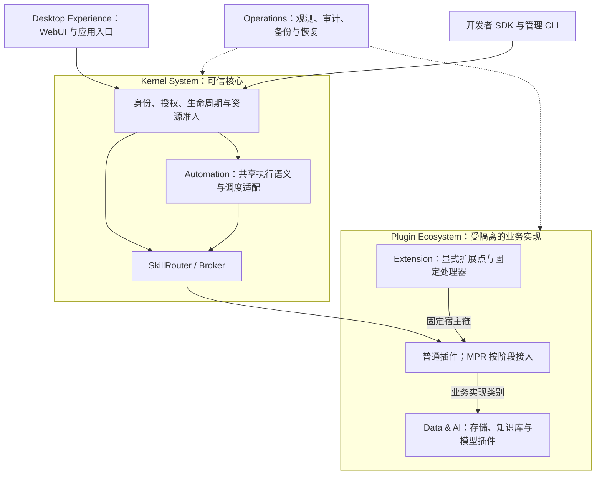

# XeLab 3.0 实施状态（2026-11-02）

[产品架构与演进规划](xelab-3.0-plan.md) · [M1 验收记录](../implementation/m1-acceptance.md)

## 实现状态与证据边界

当前 main 已合并 [PR #2](https://github.com/jyxxe/XeLab/pull/2) 与包含完整 M1 身份闭环的 [PR #4](https://github.com/jyxxe/XeLab/pull/4)；PR #3 关闭但其实现已通过 #4 进入主线。旧版“仓库只有规格、没有内核/CLI”的判断不再成立。main 的 push [Kernel M1 CI](https://github.com/jyxxe/XeLab/actions/runs/41444998012) 通过，不能据此宣称生产 RUN-03 或完整 2.8/3.0 已通过。

| 状态 | 已核对内容 | 证据与限制 |
|---|---|---|
| 已合并、已通过适用自动化 | Rust xelabd/xelabctl、PostgreSQL v1→v2 显式迁移、单节点 OCI/mTLS、签名安装/批准/启用/停用、身份/父级授权/撤权/审计、直接 Broker 调用与账本、重启恢复 | main CI 实际执行 PostgreSQL、Rust/Python 两种独立插件、真实 OCI、HTTPS/CLI；支持单副本、无状态、非流式、side_effect=none；不是完整公共 API 实现 |
| PR 已提交、未合并 | [#5 Controller 有界协调/Probe 回收](https://github.com/jyxxe/XeLab/pull/5)，分支 `fix/controller-bounded-reconciliation` | 首版 `fa28f14d3850633445c61226ce6453a52877eebf` 的 [CI](https://github.com/jyxxe/XeLab/actions/runs/41447478706) 通过；双队列轮转、跨轮游标、代次状态保留、5200 次 Probe churn、禁用积压下真实 OCI Call 恢复；后续修订以 PR 最新 head 检查为准，不等于硬实时延迟保证 |
| PR 已提交、真实验收环境阻塞 | [#6 RUN-03 工具和手册](https://github.com/jyxxe/XeLab/pull/6)，分支 `test/run03-host-acceptance` | 本地 9 项工具测试通过；本地预检仅 8 GiB 且缺 OCI 组件，不能承载 4C16G 内核及系统/插件池；正式 daemon 压力验收待合规独占 VM |
| 只有规范，尚未实现 | M2 持久卷/硬配额、Blob、Secret 绑定/撤销、一致性备份恢复；M3 Skill/OAuth/WebUI；Batch、Workflow、事件、MPR、Extension | 配置键、SQL 表、Proto/Schema 和预设 manifest 的存在不代表可运行服务；RUN-04～06/BACKUP-01 等未关闭 |
| 部分工具已存在，SDK 尚未开发 | Rust/Python 参考插件、签名/打包脚本、通用管理 CLI | Python 仅依赖生成 Proto，可独立接入；尚无独立 Rust SDK、通用模板/诊断工具或完整开发者兼容套件 |
| 产品规划 | 组合应用、开发者生态、轻量 Workspace、分层 Extension | 没有新增实体、协议字段或已交付市场；按依赖拆为可审查 PR |

上述实现结论来自源码、PR/审查及 CI；不是全面安全认证或生产容量保证。当前 M1 支持的 operationId 以 [运行指南](../../crates/kernel/README.md) 为准；其余明确拒绝，不返回假成功。

## 本轮执行映射（不同于规划第 5 节的发布门槛）

| 执行优先级 | 纵向任务与依赖 | 当前状态/下一退出条件 |
|---|---|---|
| P0 | main push CI → Controller B1/B2 | main 已核验；#5 待独立审查，不自行合并 |
| P0 | RUN-03 正式 xelabd/4C16G 压力；规划同步 | #6 提供预检/故障/调用/采集；真实 CPU/OOM/PID、父级资源/并发、管理写入、崩溃恢复和释放必须在独占宿主补齐；本 PR 同步规划 |
| P1 | M2-A 授权卷/硬配额 → M2-B Blob/Secret → M2-C 一致性备份恢复 → M2-D 升级/故障 | 尚未开始；分别独立 PR。卷满/挂载隔离、凭证撤销、独立密钥/撤权状态恢复、迁移失败/旧版拒绝/回滚限制必须有真实验收 |
| P1 | E1 SDK/模板/签名打包/契约测试 | 在现有两种插件和 CLI 基础上拆出最小 Rust SDK；基础工具可独立推进，涉及卷/Secret 的 SDK 等对应接口实现后再交付 |
| P2 | A1 单次 Skill 注册/授权/固定目标/Broker 转发 → W1 最小 WebUI | 尚未开始；先复用现有凭证来源/审批/配额，不提供绕过授权的裸调用；WebUI 仅公开管理 API，CLI 保留恢复路径 |
| P2 后续 | Batch/Workflow/Extension 前置准备 | 先完成稳定 Skill、持久输入/结果与恢复；不得提前宣称对应执行器已完成 |

后续若依赖未合并代码，明确 stacked PR 的 base 和依赖；#5/#6 都独立基于 main，不互相假定已合并。数据库结构变更必须增加可重复迁移/校验及兼容测试，保留 2.8 SQL 基线。

## 目标职责图（规划）

仅为目标关系，不表示未交付子系统已可运行。

