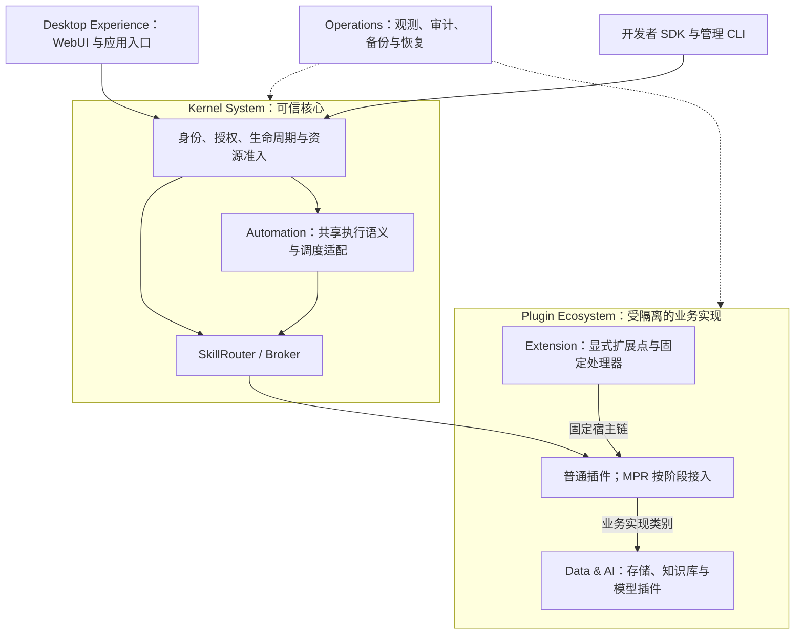

# XeLab 3.0 实施状态（2026-11-04）

[产品架构与演进规划](xelab-3.0-plan.md) · [M1 验收记录](../implementation/m1-acceptance.md)

## 实现状态与证据边界

本页以 main @ [ef6245c](https://github.com/jyxxe/XeLab/commit/ef6245c723e52ee75c82d727c1bc80b6ee0dd4b7)（已合并 PR #28，内部 Schema 13）为固定基线。
M1、Controller 稳定化、RUN-03 工具、XFS 及后续 M2 存储/恢复组件均已进入主线；PR #5/#6/#7 不再是待审实现。
最后一轮已核对的 [PR #28 完整 CI](https://github.com/jyxxe/XeLab/actions/runs/41692915217)
实际执行 OCI、XFS、Schema 13 整体恢复、PostgreSQL 回归及文档/参考协议检查。
这些证据没有关闭生产 RUN-03、正式 AWS/异机恢复或完整 2.8/3.0 发布验收。

| 状态 | 已核对内容 | 证据与限制 |
|---|---|---|
| 已合并、组件自动化通过 | Rust xelabd/xelabctl、显式追加迁移 1–13、单节点 OCI/mTLS、签名安装/批准/启用/停用、身份/父级授权/撤权/审计、直接 Broker 与账本 | Rust/Python 两种独立插件、真实 OCI、HTTPS/CLI；单副本直接调用；公开版本化格式安装仍关闭。逐项支持以运行指南为准 |
| 已合并、组件自动化通过 | [Controller 稳定化](../implementation/m1-acceptance.md)、[RUN-03 工具](../implementation/run03-host.md)、[XFS 与授权卷服务](../implementation/m2-volumes.md) | 有界扫描/Probe 回收、硬配额、预留、授权、单写者 fence、挂载、删除/扩容及恢复组件已接通；合成容量预算不是合规 daemon 容量证明 |
| 已合并、组件自动化通过 | [Blob](../implementation/m2-blobs.md)、[Secret](../implementation/m2-secrets.md)、[宿主 Blob](../implementation/m2-host-blobs.md)、[整体离线备份/恢复](../implementation/m2-platform-restores.md) | 实际加密传输、对象/文件读回、元数据/Blob/镜像/卷重建、权限重置和进程中断续作；兼容对象存储始终 off_host=false，不能替代正式 AWS/独立宿主证据 |
| 已合并、适用真实路径通过 | [重建升级/同格式回退](../implementation/m2-deployment-upgrades.md)、[初始化监督器](../implementation/m2-schema-bootstrap.md)、[格式备份登记](../implementation/m2-format-backups.md) | PR #26–28 实际 OCI/XFS、空数据初始化、已确认格式的 v1→v2→v1 程序切换与当前数据保留；不是不同业务格式转换或逆向 Apply |
| 草稿、尚未合并 | [#29 不同格式私有卷监督器](https://github.com/jyxxe/XeLab/pull/29)、[#30 Deployment Operation 完整结果](https://github.com/jyxxe/XeLab/pull/30)、[#32 恢复用户重新激活](https://github.com/jyxxe/XeLab/pull/32)、[#33 初始化后内核组件进程死亡恢复测试](https://github.com/jyxxe/XeLab/pull/33) | 各自最终 head 的完整 CI 和直接审阅仍是合并前条件；#33 依赖 #29。不能将分支代码、本地忽略测试或编译当作 main 的实际验收 |
| 尚未完成的验收 | 生产 RUN-03、完整 RUN-06/BACKUP-01、正式 AWS 支持的格式升级/不兼容回退、独立宿主恢复 | 仍需要真实合规宿主、独立密钥/备份目标和完整演练；不伪造 off_host 或 Ready |
| 只有规范，尚未实现 | M3 Skill/OAuth/WebUI；Batch、Workflow、事件、MPR、Extension | 表、配置键、Proto/Schema 和预设 manifest 不代表可运行服务 |
| 部分工具已存在，SDK 尚未开发 | Rust/Python 参考插件、签名/打包脚本、通用管理 CLI | Python 仅依赖生成 Proto；尚无独立 Rust SDK、通用模板/诊断工具或完整开发者兼容套件 |
| 产品规划 | 组合应用、开发者生态、轻量 Workspace、分层 Extension | 没有新增实体、协议字段或已交付市场；按依赖拆为可审查 PR |

上述实现结论来自源码、PR 及实际 CI；不是全面安全认证或生产容量保证。
当前支持的 operationId 以[运行指南](../../crates/kernel/README.md)为准；其余明确拒绝。

## 本轮执行映射（不同于规划第 5 节的发布门槛）

| 执行优先级 | 纵向任务与依赖 | 当前状态/下一退出条件 |
|---|---|---|
| P0 | M1 审计与最终提交回归 | Controller 基础稳定化已合并；#30 修复完整 Deployment Operation 结果，#32 补恢复后的密码激活入口；各自完整 CI 待核对 |
| P0 | RUN-03 正式 xelabd/4C16G 压力 | #6 工具已合并；真实 CPU/OOM/PID、父级资源/并发、管理写入、崩溃恢复和释放仍须在合规独占宿主执行 |
| P1 | M2 存储/恢复 → 有状态迁移与故障 | 存储与整体恢复组件已合并；推进 #29/#33，补真实 AWS 支持的升级/不兼容回退及独立宿主演练；公开格式安装在完整验证前保持关闭 |
| P1 | E1 SDK/模板/签名打包/契约测试 | 在现有两种插件和 CLI 基础上拆出最小 Rust SDK；涉及卷/Secret 的 SDK 按实际支持矩阵交付 |
| P2 | A1 单次 Skill 注册/授权/固定目标/Broker 转发 → W1 最小 WebUI | 尚未开始；复用现有凭证来源/审批/配额；WebUI 仅使用公开管理 API，CLI 保留恢复路径 |
| P2 后续 | Batch/Workflow/Extension 前置准备 | 先完成稳定 Skill、持久输入/结果与恢复；不得提前宣称对应执行器已完成 |

依赖未合并代码时明确 stacked PR 的 base 和依赖。数据库结构变更追加新版本并验证校验和、
重复迁移和兼容边界；已发布 SQL 1–13 保持不变。新 Schema 14 只在 #32 分支，不能按已发布版本操作主线。

## 本轮 M1 与恢复身份审计

| 检查 | 结论与修复位置 | 证据边界 |
|---|---|---|
| createDeployment/setDeploymentEnabled 的 Operation.result | 契约要求完整 Deployment，固定基线的两个完成路径仍返回 deployment_id 片段；#30 共享公开投影并绑定相同观察完成操作 | 实际 HTTP/PostgreSQL 回归通过；历史终态和幂等缓存不重写，最终 OCI/XFS/全工作区 CI 仍待核对 |
| 恢复后旧密码已清除的其他用户 | login 已安全拒绝 NULL 密码；缺口在没有新的激活入口。#32 增加宿主维护命令，实际 root、维护租约与当前恢复 Owner 凭证共同授权 | 子用户/其他根用户、新密码、原签发者撤销、单次响应和再次恢复撤销有实际 PostgreSQL 回归；宿主执行待最终 CI |
| 早期恢复的空 selected 继承 | 空 selected 不满足公开 Account 契约；#32 新迁移及重置使用 all_snapshot 加空权限上限，保持拒绝旧业务权限 | 实际版本 13→14 迁移、旧校验和保留、账户投影与业务权限拒绝回归通过 |
| 初始化 RPC 结果未知后的进程恢复 | #33 增加持有真实租约的内核组件进程 SIGABRT/重启，检查原检查点与只读 Verify 顺序 | 本地完成编译、参考协议与文档检查；最终特权执行待 CI，不能关闭完整生产 daemon 故障验收 |

## 目标职责图（规划）

仅为目标关系，不表示未交付子系统已可运行。

