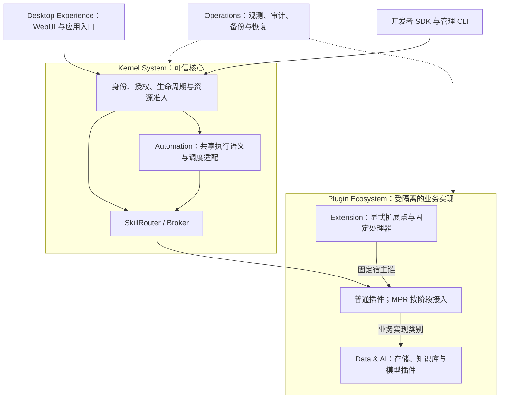

# XeLab 3.0 实施状态（2026-11-04）

[产品架构与演进规划](xelab-3.0-plan.md) · [M1 验收记录](../implementation/m1-acceptance.md)

## 实现状态与证据边界

本页以 main @ [68692e7](https://github.com/jyxxe/XeLab/commit/68692e7b9cbcfb3e9aacd9eb814304baddcb607c)（PR #29/#30/#32/#33/#34/#35/#36 已合并，内部 Schema 14）为固定基线。
M1、Controller 稳定化、RUN-03 工具、XFS 及后续 M2 存储/恢复组件均已进入主线；PR #5/#6/#7 不再是待审实现。
最后核对的 [PR #36 最终完整 CI](https://github.com/jyxxe/XeLab/actions/runs/41781861009) 实际执行 OCI、XFS、Schema 14 整体恢复、root 维护 CLI、SIGABRT 后新进程恢复、PostgreSQL 及文档/参考协议检查；测试 head 与基线 main 的完整源码树一致。整体恢复包含 none、格式 1、格式 2 三个真实卷，以及恢复后的实际业务续写。真实 AWS 用例因缺资源明确忽略，未计为通过。
这些证据没有关闭生产 RUN-03、正式 AWS/异机恢复或完整 2.8/3.0 发布验收。

| 状态 | 已核对内容 | 证据与限制 |
|---|---|---|
| 已合并、组件自动化通过 | Rust xelabd/xelabctl、显式追加迁移 1–14、单节点 OCI/mTLS、签名安装/批准/启用/停用、身份/父级授权/撤权/审计、直接 Broker 与账本 | Rust/Python 两种独立插件、真实 OCI、HTTPS/CLI；单副本直接调用；公开版本化格式安装仍关闭。逐项支持以运行指南为准 |
| 已合并、组件自动化通过 | [Controller 稳定化](../implementation/m1-acceptance.md)、[RUN-03 工具](../implementation/run03-host.md)、[XFS 与授权卷服务](../implementation/m2-volumes.md) | 有界扫描/Probe 回收、硬配额、预留、授权、单写者 fence、挂载、删除/扩容及恢复组件已接通；合成容量预算不是合规 daemon 容量证明 |
| 已合并、组件自动化通过 | [Blob](../implementation/m2-blobs.md)、[Secret](../implementation/m2-secrets.md)、[宿主 Blob](../implementation/m2-host-blobs.md)、[整体离线备份/恢复](../implementation/m2-platform-restores.md) | 实际加密传输、对象/文件读回、元数据/Blob/镜像/卷重建、权限重置和进程中断续作；兼容对象存储始终 off_host=false，不能替代正式 AWS/独立宿主证据 |
| 已合并、适用真实路径通过 | [重建升级/同格式回退](../implementation/m2-deployment-upgrades.md)、[初始化监督器](../implementation/m2-schema-bootstrap.md)、[格式备份登记](../implementation/m2-format-backups.md) | 实际 OCI/XFS、空数据初始化、已确认格式的 v1→v2→v1 程序切换与当前数据保留；不是不同业务格式转换或逆向 Apply |
| 已合并、最终 CI 通过 | [#29 不同格式私有卷监督器](https://github.com/jyxxe/XeLab/pull/29)、[#30 Deployment Operation 完整结果](https://github.com/jyxxe/XeLab/pull/30)、[#32 恢复用户重新激活](https://github.com/jyxxe/XeLab/pull/32) | 实际缺备份拒绝、完整 Deployment 投影、root 维护激活及迁移 13→14 回归；不同格式 AWS 正向迁移尚未执行，不能据此开放公开格式入口 |
| 已合并、最终 CI 通过 | [#33 初始化后内核组件进程死亡恢复](https://github.com/jyxxe/XeLab/pull/33) | 实际 SIGABRT 后用新进程保留原凭证/检查点/实例/预算，先只读 Verify，分离 scratch 后业务写入成功；合成容量的组件测试不代替生产 daemon/RUN-03 |
| 已合并、默认 CI 通过 | [#34 真实 AWS 格式升级/备份回退入口](https://github.com/jyxxe/XeLab/pull/34)及[执行步骤](../implementation/m2-aws-format-acceptance.md) | 默认完整 CI 通过：实际 OCI/XFS、96 项库测试、15 项身份测试、809 页文档、9 项参考协议及 Clippy。真实 AWS 用例因缺资源明确忽略，尚未执行，不能计作 AWS 验收 |
| 已合并、最终 CI 通过 | [#35 已验证格式的整体恢复](https://github.com/jyxxe/XeLab/pull/35)、[#36 双格式真实覆盖](https://github.com/jyxxe/XeLab/pull/36)及[格式恢复边界](../implementation/m2-platform-formats.md) | 实际源卷销毁、新 DB/CAS/XFS、进程死亡续作、字节/历史证明篡改拒绝、当前 Owner 重新登录/信任/批准后两种格式实际续写；98 项库测试、15 项身份测试、810 页文档及 9 项参考协议通过。格式 2 独立空卷初始化不是格式 1→2 迁移验收 |
| 尚未完成的验收 | 生产 RUN-03、完整 RUN-06/BACKUP-01、正式 AWS 支持的格式升级/不兼容回退、独立宿主恢复 | 仍需要真实合规宿主、独立密钥/备份目标和完整演练；不伪造 off_host 或 Ready |
| 只有规范，尚未实现 | M3 Skill/OAuth/WebUI；Batch、Workflow、事件、MPR、Extension | 表、配置键、Proto/Schema 和预设 manifest 不代表可运行服务 |
| 部分工具已存在，SDK 尚未开发 | Rust/Python 参考插件、签名/打包脚本、通用管理 CLI | Python 仅依赖生成 Proto；尚无独立 Rust SDK、通用模板/诊断工具或完整开发者兼容套件 |
| 产品规划 | 组合应用、开发者生态、轻量 Workspace、分层 Extension | 没有新增实体、协议字段或已交付市场；按依赖拆为可审查 PR |

上述实现结论来自源码、PR 及实际 CI；不是全面安全认证或生产容量保证。
当前支持的 operationId 以[运行指南](../../crates/kernel/README.md)为准；其余明确拒绝。

## 本轮执行映射（不同于规划第 5 节的发布门槛）

| 执行优先级 | 纵向任务与依赖 | 当前状态/下一退出条件 |
|---|---|---|
| P0 | M1 审计与最终提交回归 | Controller 基础稳定化、#30 完整 Deployment Operation 结果和 #32 恢复后密码激活已合并，最终 OCI/XFS/全工作区 CI 均通过；生产容量及整体故障验收仍单列 |
| P0 | RUN-03 正式 xelabd/4C16G 压力 | #6 工具已合并；真实 CPU/OOM/PID、父级资源/并发、管理写入、崩溃恢复和释放仍须在合规独占宿主执行 |
| P1 | M2 存储/恢复 → 有状态迁移与故障 | 存储、#29 私有格式监督器、#35/#36 已验证格式整体恢复均已合并并通过最终完整 CI；none/格式 1/格式 2 真实恢复及业务续写通过。真实 AWS 升级/不兼容回退及独立宿主演练仍待资源执行；公开格式安装在完整验证前保持关闭 |
| P1 | E1 SDK/模板/签名打包/契约测试 | 在现有两种插件和 CLI 基础上拆出最小 Rust SDK；涉及卷/Secret 的 SDK 按实际支持矩阵交付 |
| P2 | A1 单次 Skill 注册/授权/固定目标/Broker 转发 → W1 最小 WebUI | 尚未开始；复用现有凭证来源/审批/配额；WebUI 仅使用公开管理 API，CLI 保留恢复路径 |
| P2 后续 | Batch/Workflow/Extension 前置准备 | 先完成稳定 Skill、持久输入/结果与恢复；不得提前宣称对应执行器已完成 |

依赖未合并代码时明确 stacked PR 的 base 和依赖。数据库结构变更追加新版本并验证校验和、
重复迁移和兼容边界；已发布 SQL 1–14 及其校验和保持不变。Schema 14 已随 #32 合并，后续结构变更必须追加新版本。

## 本轮 M1 与恢复身份审计

| 检查 | 结论与修复位置 | 证据边界 |
|---|---|---|
| createDeployment/setDeploymentEnabled 的 Operation.result | #30 已将 deployment_id 片段修为完整公开 Deployment 投影，并绑定相同观察完成操作 | 最终实际 OCI/HTTP/PostgreSQL、XFS 和全工作区 CI 通过；历史终态和幂等缓存不重写 |
| 恢复后旧密码已清除的其他用户 | #32 已增加宿主维护命令，实际 root、维护租约与当前恢复 Owner 凭证共同授权；不会复活旧密码、Key 或业务 Grant | 最终实际 root CLI、撤销凭证拒绝、单次输出、子用户/其他根用户及新密码回归通过；整体恢复后权限仍清空 |
| 早期恢复的空 selected 继承 | 空 selected 不满足公开 Account 契约；#32 新迁移及重置使用 all_snapshot 加空权限上限，保持拒绝旧业务权限 | 实际版本 13→14 迁移、旧校验和保留、账户投影与业务权限拒绝回归通过 |
| 初始化 RPC 结果未知后的进程恢复 | #33 增加持有真实租约的内核组件进程 SIGABRT/重启，检查原检查点与只读 Verify 顺序 | 最终 head 913996b 的完整 CI 已实际通过，新进程恢复 23.34 秒；96 项库测试、15 项身份测试、808 页文档和 9 项参考协议通过，仍不能关闭完整生产 daemon 故障验收 |
| 不同格式迁移的真实 AWS 正向入口 | #34 新增独立宿主脚本、真实备份、Apply 未知后只派发一次并 Verify，以及不兼容备份回退到第三个卷 UUID | 默认 OCI/XFS/全工作区、参考协议均通过；AWS 用例明确忽略，缺少凭证及授权宿主，尚未执行。没有 SQL 伪造 Ready/off_host/格式证明 |
| 全平台备份仅接受 none、孤立分配漏归档 | #35 绑定原插件/发布者/清单/操作及历史证明，允许恢复已验证格式，并拒绝没有对应活逻辑卷的分配；#36 增加两种实际格式覆盖 | 最终 CI 41781799369/41781861009 均完整通过，已验证格式保留到新物理根/文件系统/项目号；历史证明不恢复旧权限，不执行 Apply 或重标格式，不修改 SQL/机器契约 |

## 目标职责图（规划）

仅为目标关系，不表示未交付子系统已可运行。

