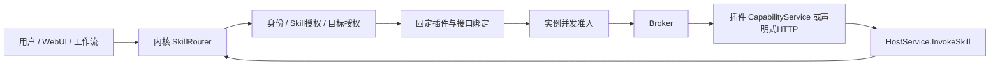

# Skill 层定位与边界

[文档总目录](../README.md)

> 规格版本：2.6.0；状态：设计预设，尚未构建或实测运行。

## 请求路径

Skill 是核心持有的版本化业务入口声明，将业务名称、输入输出、目标插件及接口绑定起来。插件仍实现原有业务接口，Skill 不增加一套独立推理进程，也不执行任意脚本或提示词代码。

本目录的 skill 不是 Codex 的 SKILL.md，也不自动授予 shell、文件系统或网络权限。

## 与已有对象的关系

| 对象 | 职责 |
|---|---|
| Plugin | 独立制品、容器、生命周期与资源 |
| Capability | 插件实现的版本化业务协议 |
| Skill | 核心对业务协议的固定入口、验证及转发规则 |
| Deployment/Instance | Skill 最终绑定的已批准运行实例 |

首版 mapping=identity，不做未定义的参数变换。HTTP 目标只接受已签名插件 OpenAPI 中 POST/JSON→200/JSON 的固定 operationId，不接受调用方 URL。其他协议通过显式新契约扩展。

生命周期、健康探针、HostService、内核用户管理和 WebUI 静态页面不作为普通业务 Skill 暴露。WebUI 预设仍调用管理 API。

业务预设声明 business_entry=skill_required，核心拒绝其裸 /calls 和无 Skill 绑定的 HostService.Invoke；客户端不能借旧入口绕过 Skill。旧插件默认 direct，现有兼容调用继续有效。

micro目标是新增的受控分支：核心仅管理微制品和固定路由，受限脚本由独立MPR执行；它不把代码装入SkillRouter。普通Plugin表中的OCI职责不适用于MicroPlugin，见[核心微类型](../architecture/micro-plugins.md)。
